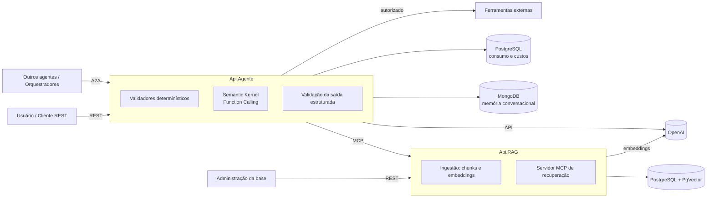

# AgenteSpedFiscal

Agente de IA para **validar**, **explicar** e **produzir** arquivos **SPED Fiscal**, combinando
validação determinística, consulta a manuais oficiais por RAG, uso controlado de ferramentas e
análise com LLM, sempre com respostas estruturadas e rastreáveis.

> **Status:** fase de especificação. A [constitution](.specify/memory/constitution.md) foi
> ratificada; ainda não há código de implementação. As funcionalidades serão construídas pelo
> fluxo de desenvolvimento orientado por especificações (SDD) descrito abaixo.

## Sumário

- [Objetivo](#objetivo)
- [Arquitetura](#arquitetura)
- [Fluxo de validação](#fluxo-de-validação)
- [Princípios fundamentais](#princípios-fundamentais)
- [Stack tecnológica](#stack-tecnológica)
- [Desenvolvimento orientado por especificações](#desenvolvimento-orientado-por-especificações)
- [Estrutura do repositório](#estrutura-do-repositório)
- [Decisões pendentes](#decisões-pendentes)
- [Contribuição](#contribuição)

## Objetivo

O AgenteSpedFiscal deve:

- validar arquivos SPED Fiscal quanto a estrutura, registros e regras aplicáveis;
- responder perguntas sobre SPED Fiscal com base em manuais oficiais, citando as fontes;
- gerar arquivos SPED Fiscal de forma determinística a partir de dados rastreáveis;
- integrar-se a outros agentes e orquestradores por **A2A**.

Layouts, regras fiscais e critérios de conformidade **não são inventados**: são obtidos de
documentos oficiais e registrados nas especificações de cada funcionalidade.

## Arquitetura

A solução é composta por dois serviços ASP.NET Core, cada um proprietário dos seus dados.



| Serviço | Responsabilidades |
|---|---|
| **Api.Agente** | API REST do agente; recebimento de arquivos; orquestração da validação e da geração; integração com a OpenAI; cliente MCP da Api.RAG; ferramentas via Semantic Kernel; memória conversacional; registro de consumo e custos; validação da resposta estruturada; servidor A2A. |
| **Api.RAG** | API REST de administração da base de conhecimento; endpoint POST de ingestão; geração de chunks e embeddings; armazenamento e busca vetorial em PostgreSQL com PgVector; servidor MCP com ferramentas de recuperação. |

Regras de fronteira:

- A comunicação funcional entre Api.Agente e Api.RAG ocorre **somente por MCP**.
- Nenhum serviço acessa diretamente tabelas, vetores ou armazenamento do outro.
- Cada serviço separa as camadas de **endpoints**, **aplicação**, **domínio** e
  **infraestrutura**.

## Fluxo de validação

Toda validação de documento segue estas etapas, nesta ordem:

1. Receber o arquivo e identificar usuário, contexto e execução.
2. Validar tamanho, formato e condições de processamento.
3. Identificar tipo de documento e versão do layout.
4. Validar estrutura, registros e schema aplicável.
5. Consultar os chunks do manual correspondente por MCP.
6. Executar ferramentas externas, quando necessário e autorizado.
7. Produzir a análise com o LLM.
8. Validar a saída estruturada.
9. Retornar o resultado com evidências e rastreabilidade.

Cada achado é classificado em exatamente uma categoria:

| Categoria | Origem |
|---|---|
| Erro estrutural | Validador determinístico |
| Inconsistência de negócio | Validador determinístico |
| Indício identificado pela IA | LLM (não comprovado) |
| Ausência de evidências | Falta de fonte ou dado |
| Falha técnica / dependência indisponível | Execução |

O agente **nunca declara conformidade** quando alguma validação obrigatória não foi concluída.

## Princípios fundamentais

Resumo da [constitution](.specify/memory/constitution.md), que é o documento normativo do
projeto:

- **Fontes oficiais** — toda regra fiscal referencia documento, versão e localização (P-01).
- **Determinismo antes do LLM** — o LLM não substitui validadores; XSD só para XML com schema
  oficial (P-02).
- **Sem fabricação** — referências e resultados de ferramentas citados precisam existir na
  execução (P-13).
- **Saída estruturada** — contrato JSON versionado e validado; metadados operacionais são
  preenchidos pelo sistema, não pelo modelo (P-11, P-12).
- **Conteúdo não confiável** — arquivos, chunks e respostas de ferramentas nunca alteram as regras
  do sistema (P-14).
- **Ferramentas governadas** — a escolha de uma ferramenta pelo LLM não autoriza sua execução
  (P-15).
- **Custos honestos** — todo consumo é registrado, inclusive retentativas; consumo desconhecido
  não vira zero (P-17).
- **Rastreabilidade** — identificador de execução propagado por REST, MCP, A2A, ferramentas e
  registros de consumo (P-18).

## Stack tecnológica

| Componente | Tecnologia |
|---|---|
| Plataforma | .NET 10, ASP.NET Core |
| LLM e embeddings | OpenAI |
| Orquestração de ferramentas | Semantic Kernel (Function Calling) |
| Comunicação Agente ↔ RAG | MCP |
| Interoperabilidade entre agentes | A2A |
| Base vetorial | PostgreSQL + PgVector |
| Consumo e custos | PostgreSQL |
| Memória conversacional | MongoDB |

Versões de SDKs, modelos e parâmetros ajustáveis são definidos nos planos técnicos, não aqui.

## Desenvolvimento orientado por especificações

O projeto usa o [Spec Kit](https://github.com/github/spec-kit) integrado ao Claude Code. O fluxo
obrigatório é:

```text
constitution → especificação → esclarecimentos → plano técnico → tarefas → implementação → validação
```

| Etapa | Comando |
|---|---|
| Constitution | `/speckit-constitution` |
| Especificação | `/speckit-specify` |
| Esclarecimentos | `/speckit-clarify` |
| Plano técnico | `/speckit-plan` |
| Tarefas | `/speckit-tasks` |
| Análise de consistência | `/speckit-analyze` |
| Implementação | `/speckit-implement` |

Cada funcionalidade mantém critérios de aceite verificáveis e rastreabilidade
requisito → tarefa → teste. Decisões arquiteturais relevantes são registradas em ADRs
(`docs/adr/`) e desvios da constitution em `docs/desvios/`.

## Estrutura do repositório

```text
.
├── .claude/skills/          # Comandos Spec Kit para o Claude Code
├── .specify/
│   ├── memory/
│   │   └── constitution.md  # Constitution do projeto (normativa)
│   ├── scripts/powershell/  # Scripts de apoio do Spec Kit
│   ├── templates/           # Templates de spec, plano, tarefas e checklist
│   └── workflows/           # Definição do fluxo SDD
└── README.md
```

Os projetos `Api.Agente`, `Api.RAG` e as pastas `docs/adr/` e `docs/desvios/` serão criados
conforme as especificações e planos técnicos.

## Decisões pendentes

A seção 9 da [constitution](.specify/memory/constitution.md#9-decisões-pendentes) lista as
decisões ainda em aberto (modelos da OpenAI, fontes oficiais e versões suportadas, escopo da
geração de SPED, autenticação, retenção de dados, parâmetros de RAG, entre outras), com a etapa em
que cada uma deve ser resolvida. Nenhuma delas é requisito aprovado.

Decisão já resolvida: **D-01 — memória conversacional em MongoDB** (ADR de registro pendente).

## Contribuição

- Toda funcionalidade começa por uma especificação aprovada.
- Todo pull request referencia a especificação e as tarefas que atende e cumpre a
  [Definition of Done](.specify/memory/constitution.md#7-definition-of-done).
- Alterações na constitution seguem versionamento semântico e exigem avaliação de impacto nas
  especificações existentes.
